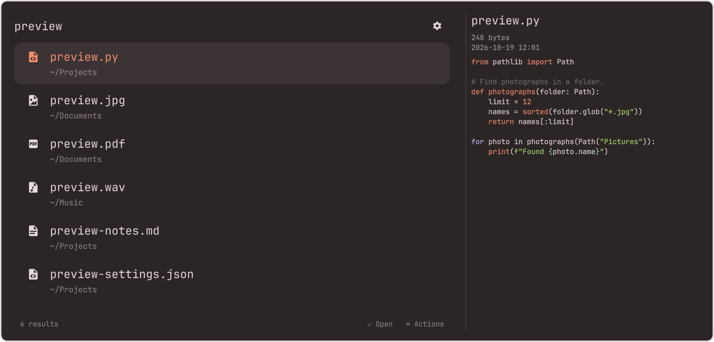
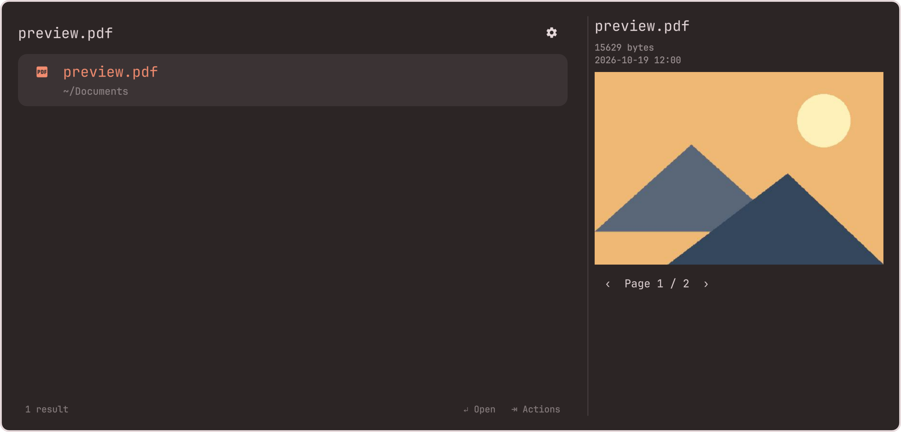
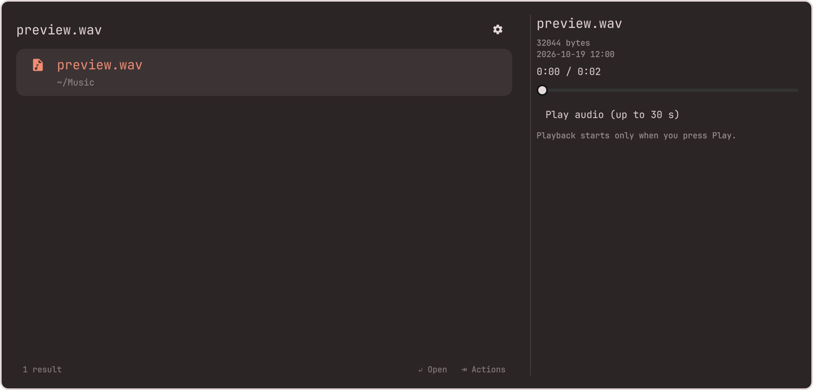
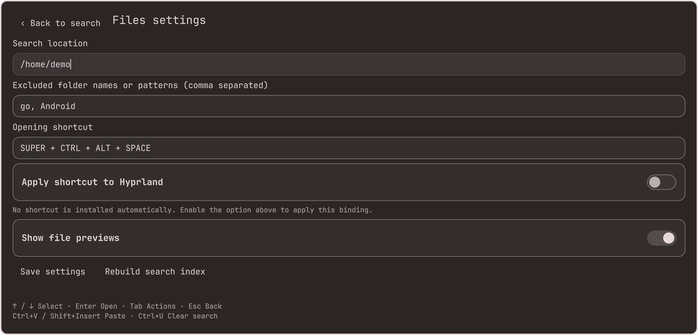

# Files for Omarchy

Find any file or folder in your home as you type, then do something with it.

A search overlay for the Omarchy shell in the spirit of LaunchBar, Alfred, and
Raycast. Results update on every keystroke, folders can be browsed into, and
every result has an actions panel: open it, open it with another app, show it
in Files, copy it, share it, or move it to the Trash. It looks and moves like
the Omarchy menu, because it is built from the same pieces.


Screenshots show the actual overlay searching synthetic files. The marketplace image shows code highlighted by Neovim using the configured theme, over Omarchy's ristretto wallpaper.

Code, PDFs, images, documents, archives and media can be previewed beside your
results. Code uses your configured Neovim theme and the system font. Audio plays
only when requested; video previews show seekable frames.

## Screenshots

<details>
<summary>See every view</summary>

### Code in your Neovim theme



### PDF pages



### Audio previews



### Settings inside the overlay



### Search as you type


### Recent files


### Actions


### Open With


### Browse folders


</details>

## Install

```bash
omarchy plugin add https://github.com/crmne/omarchy-files.git --enable --yes
```

Open the overlay with:

```bash
omarchy-shell shell toggle crmne.files
```

## Shortcut

Omarchy plugins cannot declare key bindings, so bind it yourself in
`~/.config/hypr/bindings.lua`:

```lua
o.bind("SUPER + CTRL + ALT + SPACE", "Find files", "omarchy-shell shell toggle crmne.files")
```

`Ctrl Alt Super Space` keeps file search on Space alongside Omarchy's menus.
Alt is Option on Mac keyboards. Installing the plugin does not install a
shortcut; add the binding above yourself, or configure it in the overlay settings.

## Requirements

- Omarchy Quattro with its Quickshell-based shell.
- System Python (`/usr/bin/python3`) and `python-pillow` for image thumbnails.
- Optional preview tools: `neovim` for syntax highlighting, `poppler`
  (`pdfinfo`/`pdftoppm`) for PDFs, `ffmpeg` (`ffprobe`/`ffplay`) for media,
  `librsvg` (`rsvg-convert`) for SVG, and `libarchive` (`bsdtar`) for archives.
  Missing decoders leave a preview-unavailable message; Files never installs them automatically.
- `fd`, `fzf`, `gawk`, `wl-copy`, `wl-paste`, `timeout`, `head`, and `gio`, all of which ship with Omarchy.

## Using it

Start typing. With nothing typed, the overlay lists the files you changed most
recently. The search edits like a text field: `←` `→` move the caret,
`Shift` selects, `Ctrl ←` `Ctrl →` jump by word, `Home` and `End` go to either
end, `Ctrl A` selects everything, `Ctrl Z` undoes, and you can click to place
the caret or drag to select. `Ctrl C` and `Ctrl X` copy and cut selected text;
with no text selected, `Ctrl C` copies the selected file's path.
Use `Ctrl V` or `Shift Insert` to paste into the search or either action filter.
A pasted `file://` link becomes its path.
Clipboard reads happen only on paste, in a separate process limited to 4096
bytes and two seconds (with a one-second forced-stop grace period). Line breaks
become spaces, control characters are removed, and results arriving after you
edit, navigate, or close the overlay are discarded.

| Key | Results |
|---|---|
| typing | search everything under `~` |
| `/` or `~/` first | browse that path anywhere on the system, narrowed by the name being typed |
| `Ctrl Backspace` in a typed path | climb one folder |
| `↑` `↓` `PgUp` `PgDn` | move |
| `↵` | open (files in their default app, folders in your file manager) |
| `→` at the end of the search | browse into a folder, or open the actions of a file |
| `←` at the start of the search, or `Backspace` on an empty one | go back up |
| `⇥` or `Ctrl K` | actions for the selection |
| `Esc` | clear the search, then go back up, then close |

Inside a folder, typing searches only that folder and everything below it, and
going back restores the search and selection you came from.

Type or paste a path to go anywhere, inside your home or not. `/` lists the
top of the file system, `/etc/ho` lists `/etc` narrowed to names matching
`ho`, and a full path such as `/etc/hosts` selects that file and previews it.
A folder path ending in `/` lists the folder itself first, so `↵` opens it.
`→` on a folder adds it to the path, and `Ctrl Backspace` climbs back one
folder at a time. A typed path lists everything in the folder, including
symbolic links and files your `.gitignore` excludes; hidden entries appear
once the name you type starts with a dot.

| Key | Actions panel |
|---|---|
| typing | filter the actions |
| `↵` | run the action |
| `→` at the end of the filter | open the Open With list, where `↵` launches the app |
| `Esc` | clear the filter, then go back |
| `⇧ ⇥`, `Ctrl K`, `←` at the start of the filter, or `Backspace` on an empty one | back to the results, search and selection intact |

## Settings and previews

Click the settings icon inside the overlay to flip to its settings view. Back
returns to the same search and selection. Settings include the search folder,
comma-separated exclusion patterns, opening shortcut, and a preview toggle.
Use **Rebuild search index** to refresh the saved search configuration.

Settings are stored in `~/.config/crmne-files/settings.json` (or under
`XDG_CONFIG_HOME`). Saving search settings does not change Hyprland. Enabling
**Apply shortcut to Hyprland** and saving explicitly writes
`~/.config/hypr/crmne-files.lua` and adds its include to `bindings.lua`. The view
shows the proposed shortcut before you apply it. Existing conflicting bindings
are rejected. An exact previous Files binding is migrated, hardware Search
bindings are preserved, and backups are kept beside the configuration files.
Hyprland is reloaded and checked; failed validation restores the previous files.
Supported keys are Space, letters, digits, and F1 through F12 with modifiers.

The right pane previews the selected file using the same Omarchy menu font.

| Type | Preview |
|---|---|
| Code and text | Up to 16 KiB, with Neovim syntax highlighting and the configured Neovim theme for recognized languages; UTF-8 and UTF-16 text supported |
| PDFs | Rendered pages, with previous/next page controls |
| Images | JPEG, PNG, WebP, GIF, TIFF, AVIF, ICO, JPEG 2000, PSD and other Pillow formats; HEIC/HEIF via FFmpeg when supported |
| SVG | Rasterized preview, rejecting scripts, embedded documents and external resources |
| Audio | Duration, seeking, and explicit playback of up to 30 seconds from the chosen position |
| Video | Duration, a frame preview, seeking to another frame, and explicit audio playback when present; Enter opens the full video |
| Documents | Text from DOCX, ODT/ODS/ODP, XLSX (first sheet), PPTX (first ten slides), and EPUB |
| Archives | Bounded file listing for ZIP, TAR, 7z, RAR and other libarchive formats; nothing extracted |
| Folders | Up to 200 directory entries |

Text previews use the direct Python path, without starting an editor for plain text. Code is
highlighted by a headless Neovim using its bundled syntax definitions, with a
one-second deadline and a plain-text fallback. Colors and the code background come
from the configured Omarchy Neovim theme (`~/.config/nvim/lua/plugins/theme.lua`)
and its already installed theme package. Theme options are applied; the general
Neovim init, plugin manager, modelines, swap and history remain disabled. No theme
packages are downloaded. Ad hoc colorscheme changes inside an existing editor
session are not reflected until saved in the theme configuration. The system
font is preserved; only escaped text and generated color tags reach Qt's
styled-text renderer. File contents cannot create links or embedded images.
Selection changes cancel stale work. Text waits 40 ms before loading; heavier
formats wait 120 ms to avoid decoding while you scroll quickly. Up to eight
previews (4 MiB of serialized data) are cached in memory, revalidated using file
identity, size, nanosecond timestamps and the theme configuration, and cleared when the pane closes.

Decoders run outside the shell with a 768 MiB address-space limit and five CPU
seconds. Individual preview commands have a three-second deadline and bounded
output; the whole preview has an eight-second deadline. Playback first decodes a
finite PCM excerpt, then sends that generated audio to a player, with a 40-second
overall deadline. Playback never starts automatically and stops when the
selection changes or the pane closes. Media inputs use descriptor-only protocols
and fixed demuxers, preventing playlist URLs or referenced files from being opened.

Image input is limited to 8 MiB and 16 million pixels, thumbnails to 512 pixels,
PDFs to 64 MiB, Office/EPUB documents to 32 MiB, archives to 128 MiB, and media to
2 GiB. No snippets, thumbnails or audio are written to disk or sent over the
network. Symbolic links and special files do not get content previews. Paths
outside the search folder are previewed only when you type or paste their path. Unsupported, encrypted or over-limit files show file
information or an unavailable message. The pane hides below 900 logical pixels
of screen width.

Files has no bar widget. If you installed version 1.1.0, remove its Files entry
from the bar settings; the settings button now lives inside the overlay.

To undo the managed shortcut, remove the Files `dofile(...)` line from
`~/.config/hypr/bindings.lua`, delete `~/.config/hypr/crmne-files.lua`, and reload
Hyprland. Removing the plugin does not silently edit your Hyprland configuration.

## Actions

Each action also works straight from the results, without opening the panel,
through its shortcut.

| Action | Shortcut | Applies to |
|---|---|---|
| Open | `↵` | everything, folders in your default file manager |
| Open With… | | everything, lists the apps registered for the file type |
| Show in Files | `Ctrl ↵` | everything |
| Open in Editor | `Ctrl E` | folders, code, and text, with your Omarchy editor |
| Open Terminal Here | `Ctrl T` | everything, files open their folder |
| Copy Path | `Ctrl C` | everything, when no text in the search is selected |
| Copy File (or Folder) | `Ctrl Shift C` | everything, pastes as a file in Files and most apps |
| Share | `Alt ↵` | everything, through LocalSend |
| Set as Background | | images |
| Move to Trash | `Ctrl Del` | everything, after you confirm |

Running an action closes the overlay, except Move to Trash, which drops the
row and keeps you where you were.

## Search and the index

Searching 400,000 paths has to be instant, so the plugin keeps an index:

- `fd` lists every file and folder under `~`, skipping hidden files, anything
  your `.gitignore` files exclude, and folders named `go` or `Android`.
- The list is sorted newest first and saved to `~/.cache/crmne-files/index`.
- Each keystroke runs `fzf --filter` over it, 50 ms after you stop typing.
  Ties go to the more recent file.

The index is rebuilt in the background each time the overlay opens, once the
last build is more than a minute old, and the previous index keeps answering
meanwhile. The first build takes a few seconds; the overlay says it is indexing
until it lands.

Set excluded folders from the settings button inside the overlay. The defaults
are `go` and `Android`. Different exclusions use separate indexes. Index files
are private to your user, and contain paths, never preview contents.

## Omarchy menu

To find it from the Omarchy menu as well, add this line to
`~/.config/omarchy/extensions/omarchy-menu.jsonc`:

```jsonc
"files": {"icon":"󰥨","label":"Find Files","aliases":["files","find","search files"],"action":"omarchy-shell shell toggle crmne.files"},
```

## IPC

```bash
omarchy-shell shell toggle crmne.files                             # open or close
omarchy-shell shell summon crmne.files '{"query":"invoice"}'       # open on a search
omarchy-shell shell summon crmne.files '{"scope":"Downloads"}'     # open inside a folder
omarchy-shell shell summon crmne.files '{"root":"/tmp/demo"}'      # search another folder (for demos)
omarchy-shell shell call crmne.files state ""                      # what it is showing, as JSON
```

## Remove

```bash
omarchy plugin remove crmne.files --yes
rm -r ~/.cache/crmne-files
```

## Development

Put or link this repository at `~/.config/omarchy/plugins/crmne.files` and run:

```bash
omarchy-shell shell rescanPlugins
```

After changing QML in an already loaded plugin, run `omarchy restart shell`
to clear cached components. A plugin rescan alone can retain the old code.

Rows, icons, the actions each item gets, shortcuts, breadcrumbs, and the
commands every action runs live in `FilesModel.js` as pure functions:

```bash
node --test tests/
tests/check-input               # Quickshell input/settings tests with a fake clipboard
tests/check-previews            # PDF, highlighting, cancellation and silent audio UI tests
/usr/bin/python3 tests/support.test.py
```

The helper is usable on its own:

```bash
bin/crmne-files index            # build the index now
CRMNE_FILES_QUERY="tax 2025" bin/crmne-files search
CRMNE_FILES_FOLDER=Downloads bin/crmne-files list
CRMNE_FILES_FOLDER=/etc CRMNE_FILES_QUERY=host bin/crmne-files browse   # any absolute folder
CRMNE_FILES_PATH=~/Pictures/photo.jpg bin/crmne-files apps
CRMNE_FILES_QUERY=notes bin/crmne-files --root /tmp/demo search   # any folder in place of ~
```

What you type, the folder you are in, and the file Open With looks up travel
in the helper's environment, never on a command line, where other users on
the machine could read them. `tests/helper.test.js` runs the helper and checks
the command line of everything it starts.

The search text and every path are never pasted into a shell command, so a
file named `$(anything)` stays a file name.

## License

MIT
