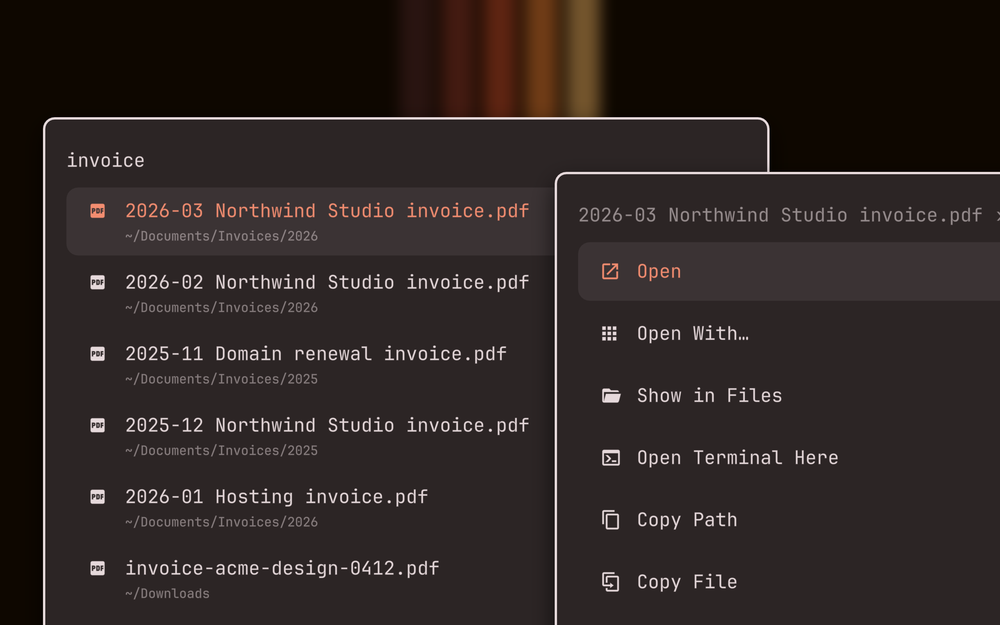
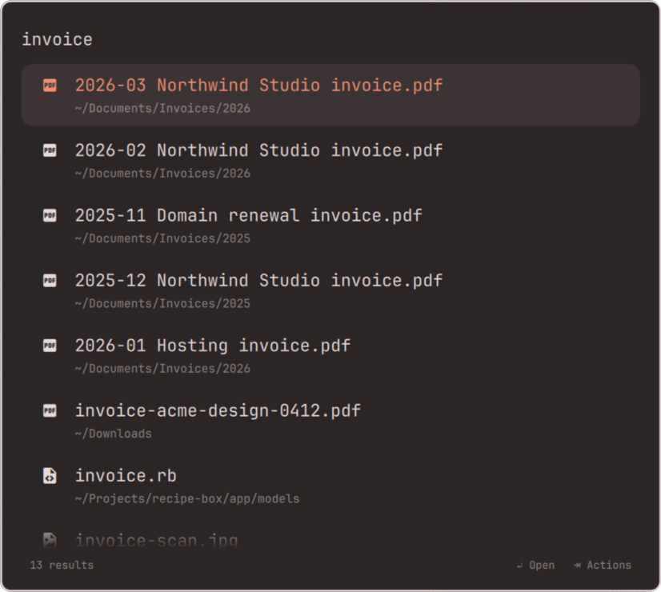
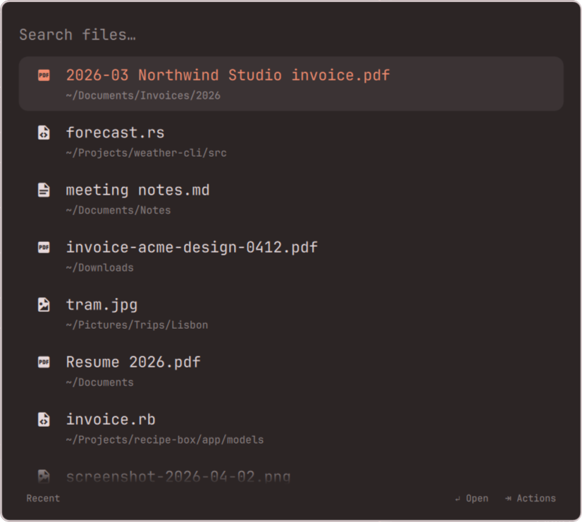
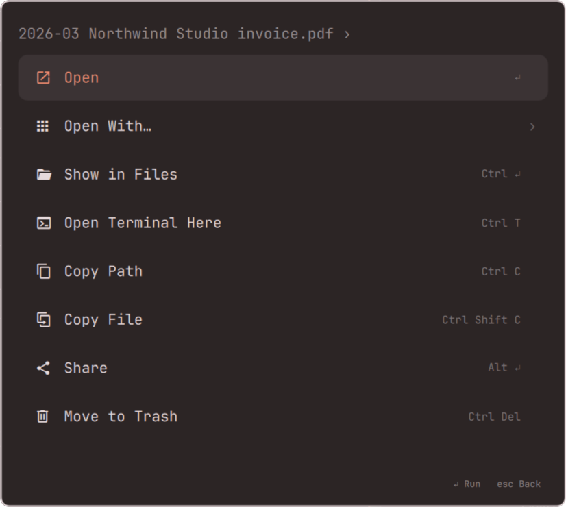
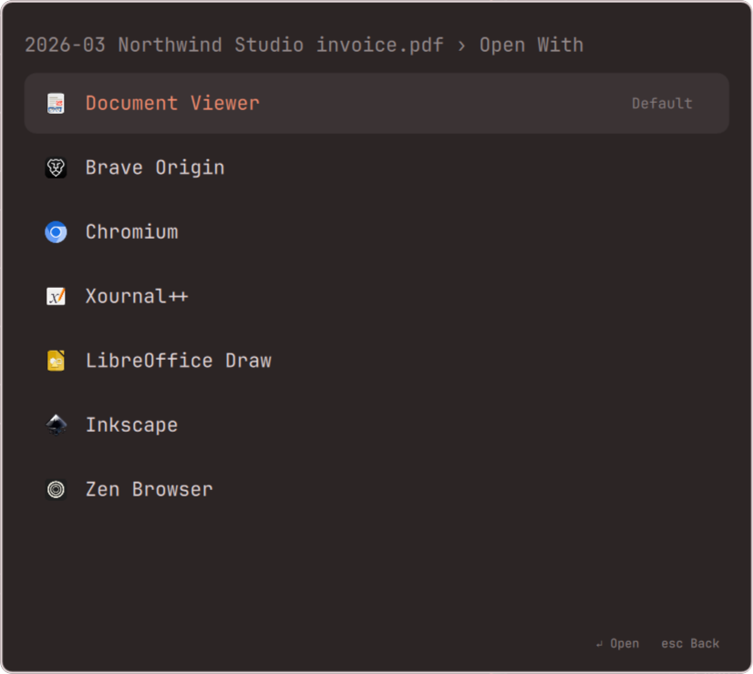
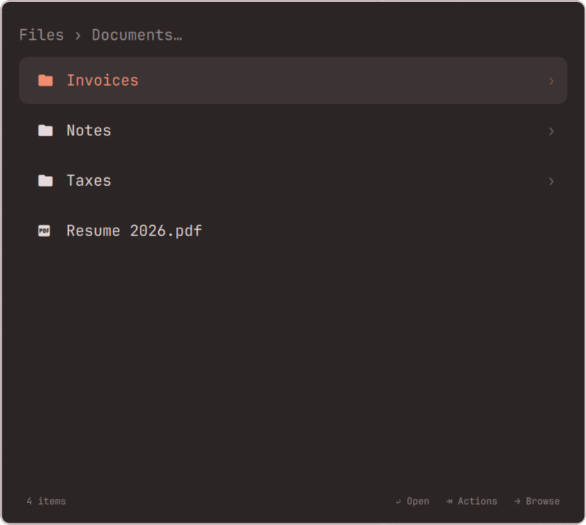

# Files for Omarchy

Find any file or folder in your home as you type, then do something with it.

A search overlay for the Omarchy shell in the spirit of LaunchBar, Alfred, and
Raycast. Results update on every keystroke, folders can be browsed into, and
every result has an actions panel: open it, open it with another app, show it
in Files, copy it, share it, or move it to the Trash. It looks and moves like
the Omarchy menu, because it is built from the same pieces.



Screenshots show the actual overlay searching a synthetic home folder, not real files. The preview above combines two of them, the results for "invoice" and the actions panel for the first one, over Omarchy's ristretto wallpaper.

## Screenshots

<details>
<summary>See every view</summary>

### Search as you type



### Recent files



### Actions



### Open With



### Browse folders



</details>

## Install

```bash
omarchy plugin add https://github.com/crmne/omarchy-files.git --enable --yes
```

Add **Files** in the bar settings to open it with a click, or summon it with:

```bash
omarchy-shell shell toggle crmne.files
```

## Shortcut

Omarchy plugins cannot declare key bindings, so bind it yourself in
`~/.config/hypr/bindings.lua`:

```lua
o.bind("SUPER + CTRL + ALT + SPACE", "Find files", "omarchy-shell shell toggle crmne.files")
```

`Ctrl Alt Super Space` keeps file search on Space alongside Omarchy's menus.
Alt is Option on Mac keyboards. Installing the plugin does not install a
shortcut; add the binding above yourself, or use the Files bar button.

## Requirements

- Omarchy Quattro with its Quickshell-based shell.
- `fd`, `fzf`, `gawk`, `wl-copy`, `wl-paste`, `timeout`, `head`, and `gio`, all of which ship with Omarchy.

## Using it

Start typing. With nothing typed, the overlay lists the files you changed most
recently. A blinking caret shows where typing and pasted text will appear.
Use `Ctrl V` or `Shift Insert` to paste into the search or either action filter.
Clipboard reads happen only on paste, in a separate process limited to 4096
bytes and two seconds (with a one-second forced-stop grace period). Line breaks
become spaces, control characters are removed, and results arriving after you
edit, navigate, or close the overlay are discarded.

| Key | Results |
|---|---|
| typing | search everything under `~` |
| `↑` `↓` `PgUp` `PgDn` | move |
| `↵` | open (files in their default app, folders in Files) |
| `→` | browse into a folder, or open the actions of a file |
| `←` or `Backspace` on an empty search | go back up |
| `⇥` or `Ctrl K` | actions for the selection |
| `Esc` | clear the search, then go back up, then close |

Inside a folder, typing searches only that folder and everything below it, and
going back restores the search and selection you came from.

| Key | Actions panel |
|---|---|
| typing | filter the actions |
| `↵` | run the action |
| `→` | open the Open With list, where `↵` launches the app |
| `Esc` | clear the filter, then go back |
| `⇧ ⇥`, `Ctrl K`, or `←` or `Backspace` on an empty filter | back to the results, search and selection intact |

## Actions

Each action also works straight from the results, without opening the panel,
through its shortcut.

| Action | Shortcut | Applies to |
|---|---|---|
| Open | `↵` | everything |
| Open With… | | everything, lists the apps registered for the file type |
| Show in Files | `Ctrl ↵` | everything |
| Open in Editor | `Ctrl E` | folders, code, and text, with your Omarchy editor |
| Open Terminal Here | `Ctrl T` | everything, files open their folder |
| Copy Path | `Ctrl C` | everything |
| Copy File (or Folder) | `Ctrl Shift C` | everything, pastes as a file in Files and most apps |
| Share | `Alt ↵` | everything, through LocalSend |
| Set as Background | | images |
| Move to Trash | `Ctrl Del` | everything, after you confirm |

Running an action closes the overlay, except Move to Trash, which drops the
row and keeps you where you were.

## Search and the index

Searching 400,000 paths has to be instant, so the plugin keeps an index:

- `fd` lists every file and folder under `~`, skipping hidden files, anything
  your `.gitignore` files exclude, and folders named `go` or `Android`.
- The list is sorted newest first and saved to `~/.cache/crmne-files/index`.
- Each keystroke runs `fzf --filter` over it, 50 ms after you stop typing.
  Ties go to the more recent file.

The index is rebuilt in the background each time the overlay opens, once the
last build is more than a minute old, and the previous index keeps answering
meanwhile. The first build takes a few seconds; the overlay says it is indexing
until it lands.

To skip other folders, edit `EXCLUDES` at the top of `bin/crmne-files`.

## Omarchy menu

To find it from the Omarchy menu as well, add this line to
`~/.config/omarchy/extensions/omarchy-menu.jsonc`:

```jsonc
"files": {"icon":"󰥨","label":"Find Files","aliases":["files","find","search files"],"action":"omarchy-shell shell toggle crmne.files"},
```

## IPC

```bash
omarchy-shell shell toggle crmne.files                             # open or close
omarchy-shell shell summon crmne.files '{"query":"invoice"}'       # open on a search
omarchy-shell shell summon crmne.files '{"scope":"Downloads"}'     # open inside a folder
omarchy-shell shell summon crmne.files '{"root":"/tmp/demo"}'      # search another folder (for demos)
omarchy-shell shell call crmne.files state ""                      # what it is showing, as JSON
```

## Remove

```bash
omarchy plugin remove crmne.files --yes
rm -r ~/.cache/crmne-files
```

## Development

Put or link this repository at `~/.config/omarchy/plugins/crmne.files` and run:

```bash
omarchy-shell shell rescanPlugins
```

After changing QML in an already loaded plugin, run `omarchy restart shell`
to clear cached components. A plugin rescan alone can retain the old code.

Rows, icons, the actions each item gets, shortcuts, breadcrumbs, and the
commands every action runs live in `FilesModel.js` as pure functions:

```bash
node --test tests/
tests/check-input               # Quickshell input tests with a fake clipboard
```

The helper is usable on its own:

```bash
bin/crmne-files index            # build the index now
CRMNE_FILES_QUERY="tax 2025" bin/crmne-files search
CRMNE_FILES_FOLDER=Downloads bin/crmne-files list
CRMNE_FILES_PATH=~/Pictures/photo.jpg bin/crmne-files apps
CRMNE_FILES_QUERY=notes bin/crmne-files --root /tmp/demo search   # any folder in place of ~
```

What you type, the folder you are in, and the file Open With looks up travel
in the helper's environment, never on a command line, where other users on
the machine could read them. `tests/helper.test.js` runs the helper and checks
the command line of everything it starts.

The search text and every path are never pasted into a shell command, so a
file named `$(anything)` stays a file name.

## License

MIT
